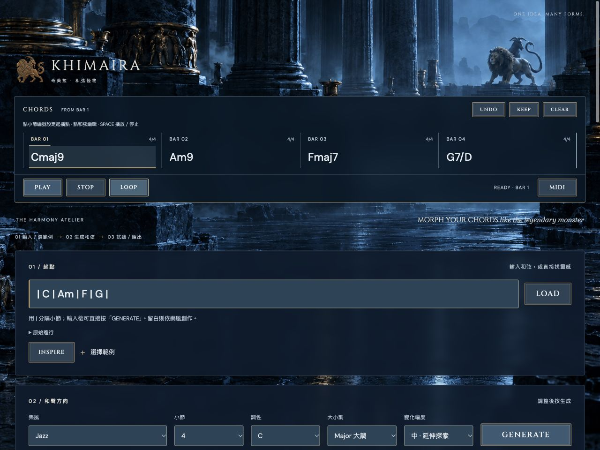
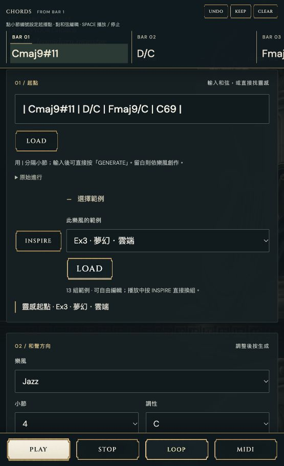
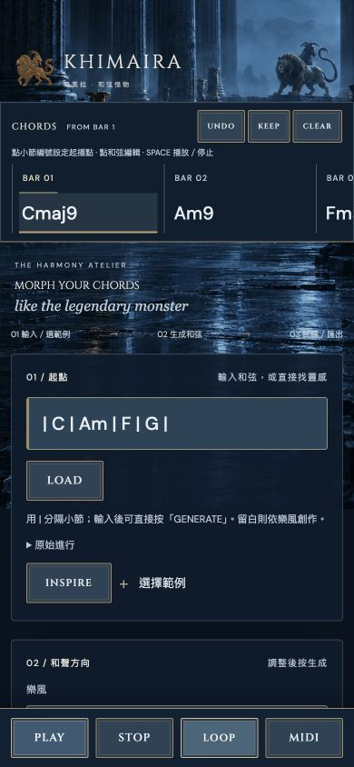
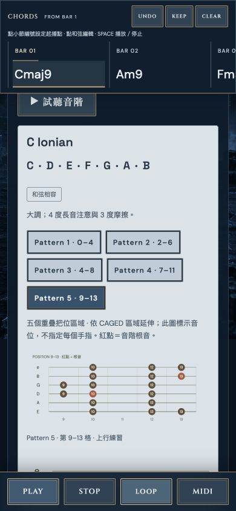

# Khimaira奇美拉 - 和弦怪物

**Morph your chords like the legendary monster**

[開啟 KHIMAIRA 網站](https://bbcode1111.github.io/Khimaira/) · 免費使用，不需登入。

KHIMAIRA 是給作曲、編曲與吉他手的和聲探索工具。輸入一條簡單進行，讓它長出不同的和聲色彩、聲部與演奏方式，再把 MIDI 帶進 DAW。



前一版網頁穩定基準：**1.0.2**（`web-v1.0.2`，2026-10-27）。[修正與驗證紀錄](docs/stable-20261027/REPORT.md)。原生外掛另行開發與驗證。

## 2026-10-28 調性與骨幹更新

KEY 統一放在播放欄。輸入 LOAD 建立骨幹；GENERATE 把骨幹發展成所選樂風；INSPIRE 提供同調式的範例或範例變化；範例 LOAD 原樣移至目前主音。三者保留骨幹，RESTORE 可回家；KEEP 需確認，可 UNDO。

AUTO 依輸入判定；選主音會移調，保留原本 AUTO／LOCK 狀態。Also fits 是保留音高的改判，與移調分開。大小調轉換是獨立確認動作。網站 MIDI 匯出包含使用者目前速度。新版保留舊存檔演奏，支援名稱／級數輸入。外掛 1.4 另行開發，未隨網站部署。

## 從四個和弦開始

1. 輸入 `| C | Am | F | G |`，可直接按「GENERATE」。想聽原樣時按「LOAD」；留白則依樂風生成。
2. 在播放欄選調；在生成區選樂風、小節數與變化幅度，再按生成。速度放在演奏區。
3. 展開「進階和聲」可選 Mutation、和弦密度與保留根音；再按相同手法或 **GENERATE** 就會換一組變體。
4. 低隨機性保留原來的根音與功能；中度加入延伸與句型改寫；高度允許更大的根音替代與和聲重構。局部 ii–V 依下一個目標和弦產生：選 C 後按 **ii–V → NEXT**，`| C | Am |` 會變成 `| C:2 Bm7b5:1 E7b9:1 | Am |`。目標可在同小節；空間不足時保留原譜並提示。最後一小節只有在 LOOP 開啟時連回開頭。
5. 點擊橫向和弦譜上的任何和弦，用選擇器換根音、種類、斜線低音與延伸音。可以分割一個和弦、移除和弦、Undo，或把結果設為新起點。
6. 按 PLAY 從起播點試聽；播放中再按 PLAY 會重新開始，按 STOP 停止。空白鍵可直接切換播放／停止；輸入欄內的空白鍵仍用於打字。點 BAR 編號設定起播小節，播放中點另一小節可跳轉。LOOP 從選定小節循環至結尾。
7. MIDI 匯出目前演奏；SUSTAIN 匯出原樣長音。匯出保留整條和弦譜，不受試聽起播點影響。

小節中可放多個和弦。`| C:2 Dm7:1 G7:1 |` 代表 C 兩拍、Dm7 一拍、G7 一拍。`Am` 是 A 小和弦，`AM` 是 A 大和弦。


## 不同樂風，不同演奏

原有 25 種方向：Jazz、Gospel、Fusion、Bossa nova、Rock、Japanese rock、Deep / Soulful House、Classical、Phrygian dominant、Dorian folk、Soul、R&B、Funk、EDM、Lo-fi hip-hop、Chill、Neo-soul、American pop、Mandopop、K-pop、Major blues、Minor blues、Neoclassical rock、Nu-disco、Ambient。

- **Deep / Soulful House**：持續九和弦、共同音、疏密交替的切分與獨立低音，建議 114–124 BPM。
- **古典戲劇搖滾**：小調與和聲小調色彩、半音低音線、踏板音、鋼琴 ostinato。
- **大小調 Blues**：12 小節框架、quick change、ii–V / iiø–V，以及 turnaround。選 12 bars 可保留完整練習曲式。
- **Soul / R&B / Neo-soul**：延伸和聲、borrowed iv、次屬與有呼吸的演奏。
- **Funk / Lo-fi / Chill**：以休止、音長、重音、留白與聲部配置建立不同節奏感。

目前提供 48 種樂風；演奏包含精準長音、swing comping、Bossa、Deep House、Funk、Lo-fi、各式 arpeggio，以及古典分解。音符時間、音長與力度的調整會寫入 MIDI。

範例採「Ex1 · 明亮・輕快」、「Ex2 · 憂鬱・深夜」等簡短標題，不顯示歌名。48 種樂風各有 7～13 組，共 382 組範例：包含 38 組參考短句、既有風格練習，168 組原創明亮／憂鬱／夢幻／張力練習，以及 48 組黑暗／重型練習。

INSPIRE 先帶你比較四個方向，再交錯探索其餘範例；完整輪過後才回到開頭。LOAD 和 INSPIRE 共用同一份清單，不會只在幾首參考進行中重複。播放中按 INSPIRE 會從新範例第一小節接著試聽，保留 BPM；新範例會套用相應的音長與配置，之後仍可手動調整。

不同方向改變根音走向、大小調色彩、延伸音、和聲密度或持續低音。地域調式練習保留其音列，情緒名稱是相對的聆聽提示。大／小調藍調的新範例保留 12 小節曲式，選 12 bars 可聽完整版本。

參考素材為移調、節奏正規化的短和聲骨架，不含旋律或歌詞，也不是完整錄音逐音重現；素材池為內建資料，不是即時榜單服務。



## 地域音樂與跨文化流行

新增 17 種方向，依組別放在同一個樂風選單；範例仍使用 Ex 編號。

| 方向 | 和聲／音階重點 |
| --- | --- |
| 希臘 Hijaz、阿拉伯 Hijaz 色彩 | 大主和弦、小 iv、半音與增二度，主音踏板 |
| 日本 Hirajoshi、In-sen | 兩組不同五聲音列，稀疏撥弦與開放配置 |
| 迦納 Guitar Highlife | 大調 I–IV–V、交錯分解與切分 |
| 衣索比亞 Tizita | 大調型五聲、短句應答 |
| 夏威夷 Slack-key 靈感 | I–IV–V、交替低音與上方旋律 |
| 北美原住民笛的當代五聲練習 | 小五聲、持續低音與呼吸留白 |
| 印度 Bhupali、Yaman 音列 | Sa／Pa 持續音；Bhupali 五聲、Yaman 升四度 |
| Afrobeats、Amapiano | 切分和聲與低音應答、七九和弦循環 |
| Reggaeton、Dancehall、Latin pop | Dembow 啟發落點、離拍 vamp、3–3–2 和聲節奏 |
| Flamenco、愛爾蘭／凱爾特 Dorian | 安達魯西亞終止、Dorian i–IV 與空五度 |

地域預設使用固定調式；「調性」選擇主音，「大小調」顯示「調式 · 依樂風」。吉他工具優先顯示該樂風的音階、完整音名與五個把位，也標出和弦衝突音。一般自由改寫會遵守預設音集；使用者明確選取 ii–V、三全音代理或保留根音時，可進入融合和聲。

這些是以研究為基礎的**原創現代伴奏練習**，採十二平均律與 4/4；音階相同不代表文化或旋律句法相同。印度項目未重建完整 raga、meend 或 tala，Hijaz 未模擬細部音準，北美項目不代表所有族群。夏威夷吉他圖仍為 EADGBE 標準調弦；演奏與 MIDI 只提供音高節奏，沒有鼓組或 log-drum 音色。

## 精簡操作與視覺

主要流程為「輸入／選範例 → 生成 → 試聽／匯出」。進階和聲、演奏細節、吉他工具和 Chord Melody 可各自展開，原有功能完整保留。背景採冷藍色希臘神殿與遠方奇美拉，搭配青銅浮雕 Logo、半透明深藍面板、藍灰按鈕與古銅細框。Cinzel 標題字體保留古典感；和弦符號清楚呈現，吉他圖使用淺藍底色。桌面使用寬版和弦譜；直式手機使用精簡固定和弦列與底部 PLAY／STOP／LOOP／MIDI 控制。

和弦譜位於最上方並保持可見，下面才是 01／02／03 功能。手機直式使用薄和弦列，底部固定 PLAY／STOP／LOOP／MIDI。和弦內音轉位與平行大小調色彩在 02 區；COLOR 保留延伸音及相容低音，特殊結構請用 EDIT 手動處理。



## 吉他的音位與旋律

展開「吉他工具」後，每個和弦提供多種音階選擇，列出完整音名，並提供五個可切換的指板區域和六線譜練習。五個區域參照 CAGED 的位置分布；圖中標示音位，不指定手指編號。

例如 C Dorian：`C D Eb F G A Bb`。相容音階和較有張力的色彩音階分開標示。



展開 **Chord Melody**，即可為整條進行選擇四音吉他按法，兼顧低音、三七音、把位移動及最高音的旋律方向。再按 Generate 會換一組頂聲部走向。可選指板區域、用鋼琴試聽實際吉他音高，或匯出按法 MIDI。

圖中 `×` 表示該弦不彈；可省略的五音或色彩音會列在卡片上。若指定區域沒有合適按法，會清楚顯示空缺，請放寬把位或簡化和弦。這是原創頂聲部和弦練習，不會重現參考歌曲的旋律。


## 黑暗／重型與另類

樂風下拉選單新增獨立分類，每種有 **8 組**可用 INSPIRE 輪替的和弦範例，保留簡短的 Ex 編號與氣氛標題：猛烈、陰鬱、詭異、莊嚴。

| 樂風 | 和聲與演奏 |
| --- | --- |
| Heavy Metal | Power chord、♭II、三全音根音張力；144 BPM 低音 gallop |
| Doom / Sludge | 低速重擊、長音、半音摩擦；64 BPM |
| Grunge | Power / sus、下降進行、大小調混用；102 BPM 重擊與留白 |
| Alternative | 三度關係、調外和弦、IV–iv 借用；112 BPM 破碎音型 |
| Gothic / Darkwave | 小調、踏板低音與 V→i；116 BPM 冷峻八分反覆 |
| Requiem | 下降低音、減七、拿坡里 ♭II6→V→i；62 BPM 合唱式長音 |

這些風格的生成保留其三和弦、power chord、sus 和半音色彩，不會自動套入原本的柔和爵士延伸和弦。低變化幅度保留輸入根音；自由改寫的高變化幅度可重構進行。Power chord 的吉他音階選項也包含自然小調、Phrygian、和聲小調與小調藍調。

網站以鋼琴呈現和聲與節奏；MIDI 可交給失真吉他、合成器、弦樂或合唱音源。Requiem 是 **4/4 原創安魂曲色彩練習**，並非原曲轉錄、完整安魂彌撒或嚴格四部合唱寫作。切換到 ARP 也能將這些進行化成快速反覆音型。

## ARP 合成器分解

在 **03 / 帶進作品 → 演奏方式** 選 **ARP · 合成器分解**，即可將目前和弦展開為合成器音序，無須重寫和弦。

- **11 種音序**：UP、DOWN、UP / DOWN（端點不重複）、INCLUSIVE（端點重複）、OUTSIDE IN、INSIDE OUT、RANDOM、WALK、PEDAL、POLY、MIXED。
- **音符細分**：1/4、1/8、1/8T、1/16、1/24、1/32。1/24 即十六分三連音，4/4 每小節 24 步；這是節奏細分，不是音訊 bit depth。三連音維持等距，不套用 Swing。
- **1–4 八度**，使用目前上聲部配置；POLY 每步同時彈出整個和弦，並依八度範圍輪換音區。MIXED 每四步結合一次和弦與三次單音。
- **DRIVE**：緊湊、戲劇、古典搖滾；16 分往返與兩八度。**NEON**：明亮、推進、EDM；16 分上行與三八度。**PULSE**：厚實、反拍重音；8 分 POLY。這些按鈕調整演奏，不改動和弦或 BPM。
- **RESTART / FLOW** 決定換和弦時重新起頭或接續音序步數；時間格線持續對齊 BPM。可選正拍、反拍或均勻重音；GATE、SWING、HUMAN FEEL 在「演奏細節」中調整。
- RANDOM / WALK 按 **VARIATE** 換一組固定變體；重播、重新載入與 MIDI 匯出保留同一音序。預覽圖顯示第一小節的實際音高與音長。

網頁仍以鋼琴預聽音序。按 **MIDI** 下載完整分解音符，拖入 DAW 的軟體樂器軌並選擇合成器音色；不需再加一個 arpeggiator。想自行編排時，按 **SUSTAIN** 匯出原始長和弦。檔名包含 ARP 模式、細分與八度，方便辨識。

## MIDI 與 DAW

- BPM 可在播放中即時調整，保留目前拍點；4/4 的 60、120、240 BPM 分別是每小節 4、2、1 秒。
- GATE 調整節奏短音的長短；Ballad、Ambient 等連奏聲部與持續低音保留到下一個落點，避免換和弦前整段消音。短音尾音隨時值縮短，長音模式維持完整拍數；音階與 Chord Melody 試聽也跟隨 BPM。
- 試聽與 MIDI 共用音符資料；同音重複攻擊會合併或正確銜接，避免音符互相截斷。匯出保留音長、力度、Swing 與分解節奏。
- 標準 MIDI、480 PPQ，寫入使用者目前 tempo。下載 `.mid` 後拖入 DAW，可選擇採用檔案速度或保留專案速度。
- **原樣長音**準確填滿每個和弦的拍數，不套用 humanize、swing 或 gate，方便在 DAW 自行編排。
- **目前演奏**使用和試聽相同的音序資料。
- **吉他按法 MIDI**使用圖中實際弦／格所對應的音高。
- 網頁使用鋼琴採樣；DAW 由你選的樂器發聲。網站是和聲／MIDI 工具，沒有鼓組或完整伴奏製作；`plugin/` 外掛版本另提供 DAW transport 同步。

## 本機啟動

無需安裝前端依賴。使用 Python 3：

```sh
python3 -m http.server 5173 --directory dist
```

開啟 `http://localhost:5173`。進行和設定儲存於目前瀏覽器的 localStorage。測試需要 Node.js：

```sh
npm test
```

網站原始碼與靜態資產在 `dist/`；測試在 `tests/`。儲存庫包含網站、外掛原始碼、建置流程、使用說明和截圖。研究、對話、發佈憑證與主機設定不包含在此儲存庫。

## 採樣授權

鋼琴使用 Alexander Holm 的 **Salamander Grand Piano** 採樣，CC BY 3.0，經 Tone.js 公開版本分發。網站保留採樣標示與授權連結，詳見 [About / 採樣授權](dist/research.html)。

## 網站部署

GitHub Pages 發布 `dist/` 的靜態網站。推送至 `main` 時，GitHub Actions 會先驗證和聲與播放測試，再自動部署；也可在 Actions 手動執行 Publish KHIMAIRA。研究與討論紀錄不會上傳到網站。


## 1.0.1 評測修正（2026-10-26）

- 和弦依調性選擇升降記號，次屬和弦依目標字母級數拼字；支援 `Csus`、`C+`、`C°`、`Cm(maj7)`、`C-7`、`C7b5`、`Cadd2`、`C2`、`Cmaj`。
- b9／9／11／13 的上聲部省略根音，延伸音放在核心和弦音上方，上聲部最多五音、最低 E3；低音與上聲部至少隔一個八度。減和弦目標使用 iiø–V7b9。
- 和弦格顯示羅馬級數；`KEY − / +` 將目前譜與原始進行移調半音，UNDO 同時還原調性與來源。COPY 可複製和弦名或羅馬級數及拍數。
- 上方 `MIDI ⇣` 匯出目前演奏；03 區保留 SUSTAIN，並可選合併或 **Bass / Chords 分軌**（SMF Type 1，480 PPQ，無 tempo 事件）。ARP 全部屬上聲部，分軌時低音軌為空。
- MIDI 力度採標準 127 比例；Funk／Fusion 與一般 16 分分解套用 Swing。Lo-fi 全部上聲部依生成時 BPM 延後 30ms，低音準時；播放中變速仍以拍點為基準。Rock 改為低音八分、和弦在第 2、4 拍加重。
- 演奏細節新增 Jazz 根音／2-feel／4-feel，以及 Ballad 上聲部晚半拍的選項。
- 初次啟動套用 Jazz 的演奏方式與配置；已有手動設定保持。LOOP 有亮底與指示燈，PLAY 播放時維持亮底 PLAY，可再次按下重新播放；停止使用 STOP，空白鍵切換播放／停止。手機主要按鈕與小節起播鍵至少 44px。
- 圖片採 WebP，Cinzel／DM Sans 字體隨網站附帶並保留 OFL 授權。

完整修正與驗證範圍見 [評測修正紀錄](docs/review-20261026/REPORT.md)。外掛來源已整合至 [plugin/](plugin/README.md)，手動 Actions **Build KHIMAIRA Plug-in** 可建置 Universal macOS 與 Windows 安裝包。

## MORPH 更新（2026-10-28）

範例 LOAD 直接成為新骨幹；MORPH 保留根音、順序與指定低音，以樂風上色並加入接向下一個目標的經過和弦。RESTORE 回到載入的骨幹，UNDO 可回到 LOAD 前。INSPIRE 是預覽，KEEP 才採用。詳見 [發布紀錄](docs/morph-backbone/README.md)。
