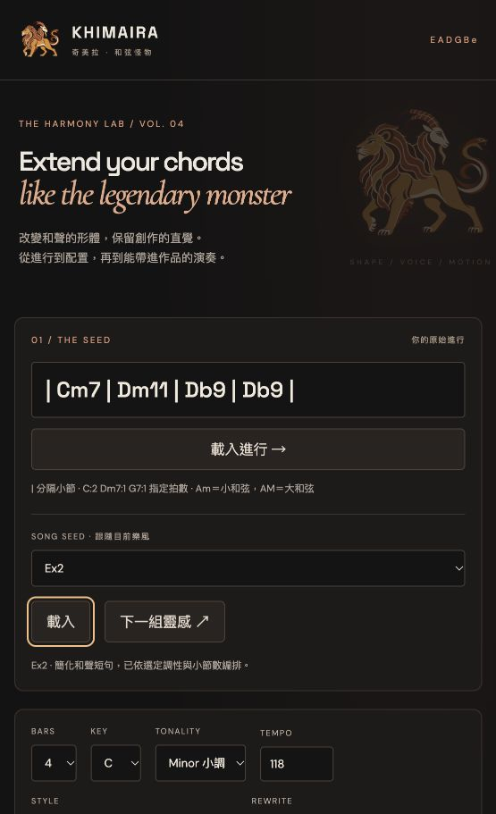
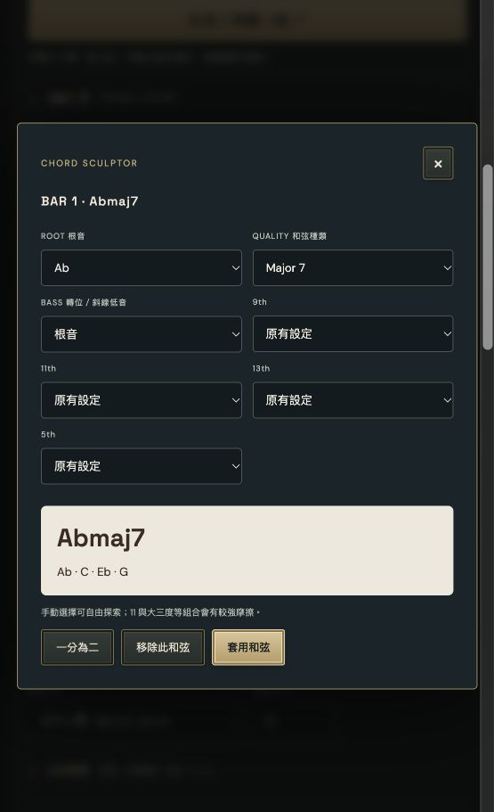
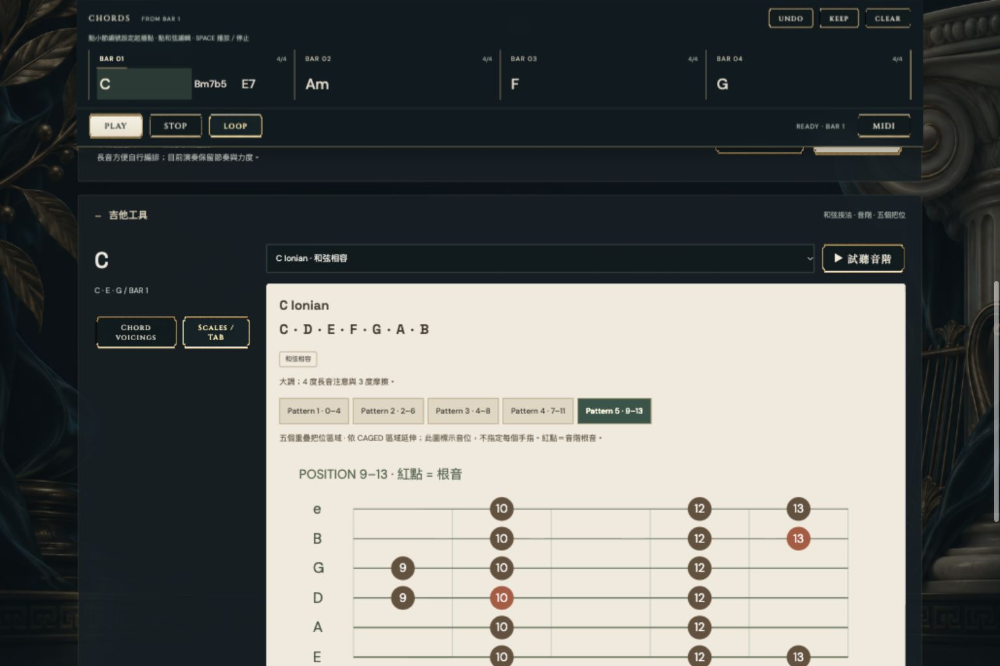
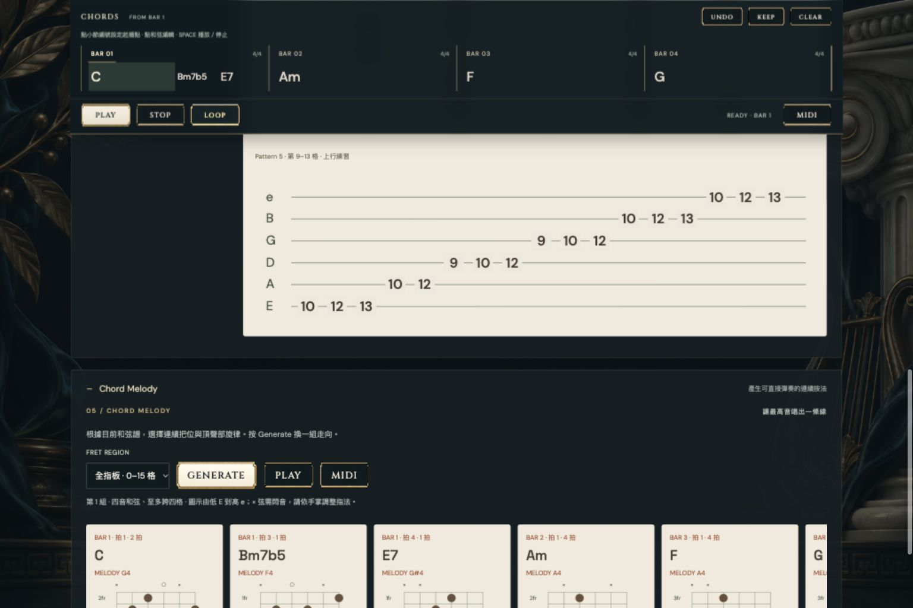

# Khimaira奇美拉 - 和弦怪物

**Extend your chords like the legendary monster**

KHIMAIRA 是給作曲、編曲與吉他手的和聲探索工具。輸入一條簡單進行，讓它長出不同的和聲色彩、聲部與演奏方式，再把 MIDI 帶進 DAW。



## 從四個和弦開始

1. 輸入 `| C | Am | F | G |`，按「載入進行」。也可以清空後直接生成。
2. 選擇 4、8、12 或 16 小節、調性、速度和樂風。
3. 選一種 Mutation，再按相同按鈕或 **Mutate · 再變一組**，就用相同手法換一組變體。
4. 低隨機性保留原來的根音與功能；中度加入延伸與句型改寫；高度允許更大的根音替代與和聲重構。局部 ii–V 依下一個目標和弦產生。
5. 點擊橫向和弦譜上的任何和弦，用選擇器換根音、種類、斜線低音與延伸音。可以分割一個和弦、移除和弦、Undo，或把結果設為新起點。
6. 試聽、調整演奏，下載長音 MIDI 或目前演奏 MIDI。

小節中可放多個和弦。`| C:2 Dm7:1 G7:1 |` 代表 C 兩拍、Dm7 一拍、G7 一拍。`Am` 是 A 小和弦，`AM` 是 A 大和弦。



## 不同樂風，不同演奏

25 種方向：Jazz、Gospel、Fusion、Bossa nova、Rock、Japanese rock、Deep / Soulful House、Classical、Phrygian dominant、Dorian folk、Soul、R&B、Funk、EDM、Lo-fi hip-hop、Chill、Neo-soul、American pop、Mandopop、K-pop、Major blues、Minor blues、Neoclassical rock、Nu-disco、Ambient。

- **Deep / Soulful House**：持續九和弦、共同音、疏密交替的切分與獨立低音，建議 114–124 BPM。
- **古典戲劇搖滾**：小調與和聲小調色彩、半音低音線、踏板音、鋼琴 ostinato。
- **大小調 Blues**：12 小節框架、quick change、ii–V / iiø–V，以及 turnaround。選 12 bars 可保留完整練習曲式。
- **Soul / R&B / Neo-soul**：延伸和聲、borrowed iv、次屬與有呼吸的演奏。
- **Funk / Lo-fi / Chill**：以休止、音長、重音、留白與聲部配置建立不同節奏感。

29 種演奏包含精準長音、swing comping、Bossa、Deep House、Funk、Lo-fi、各式 arpeggio，以及古典分解。音符時間、音長與力度的調整會寫入 MIDI。

範例以 Ex1、Ex2 等編號顯示，每個樂風各自編號。「下一組靈感」跟隨目前樂風，在 38 組歌曲和聲短句與風格練習中輪替。歌曲素材是移調、節奏正規化的短和聲骨架，不包含旋律或歌詞，也不是完整錄音的逐音重現。素材池為內建資料，不是即時榜單服務。

## 吉他的音位與旋律

每個和弦提供多種音階選擇，列出完整音名，並提供五個可切換的指板區域和六線譜練習。五個區域參照 CAGED 的位置分布；圖中標示音位，不指定手指編號。

例如 C Dorian：`C D Eb F G A Bb`。相容音階和較有張力的色彩音階分開標示。



**Chord Melody** 為整條進行選擇四音吉他按法，兼顧低音、三七音、把位移動及最高音的旋律方向。再按 Generate 會換一組頂聲部走向。可選指板區域、用鋼琴試聽實際吉他音高，或匯出按法 MIDI。

圖中 `×` 表示該弦不彈；可省略的五音或色彩音會列在卡片上。若指定區域沒有合適按法，會清楚顯示空缺，請放寬把位或簡化和弦。這是原創頂聲部和弦練習，不會重現參考歌曲的旋律。



## MIDI 與 DAW

- 標準 MIDI、480 PPQ，不寫入 tempo 事件。下載 `.mid` 後拖入 DAW，使用 DAW 專案速度；匯入時保留專案 tempo 設定。
- **原樣長音**準確填滿每個和弦的拍數，不套用 humanize、swing 或 gate，方便在 DAW 自行編排。
- **目前演奏**使用和試聽相同的音序資料。
- **吉他按法 MIDI**使用圖中實際弦／格所對應的音高。
- 網頁使用鋼琴採樣；DAW 由你選的樂器發聲。這是和聲／MIDI 工具，沒有鼓組、完整伴奏製作或即時 DAW 同步。

## 本機啟動

無需安裝前端依賴。使用 Python 3：

```sh
python3 -m http.server 5173 --directory dist
```

開啟 `http://localhost:5173`。進行和設定儲存於目前瀏覽器的 localStorage。測試需要 Node.js：

```sh
npm test
```

網站原始碼與靜態資產在 `dist/`；測試在 `tests/`。GitHub 僅包含網站、使用說明和截圖。研究、對話、發佈憑證與主機設定不包含在此儲存庫。

## 採樣授權

鋼琴使用 Alexander Holm 的 **Salamander Grand Piano** 採樣，CC BY 3.0，經 Tone.js 公開版本分發。網站保留採樣標示與授權連結，詳見 [About / 採樣授權](dist/research.html)。
