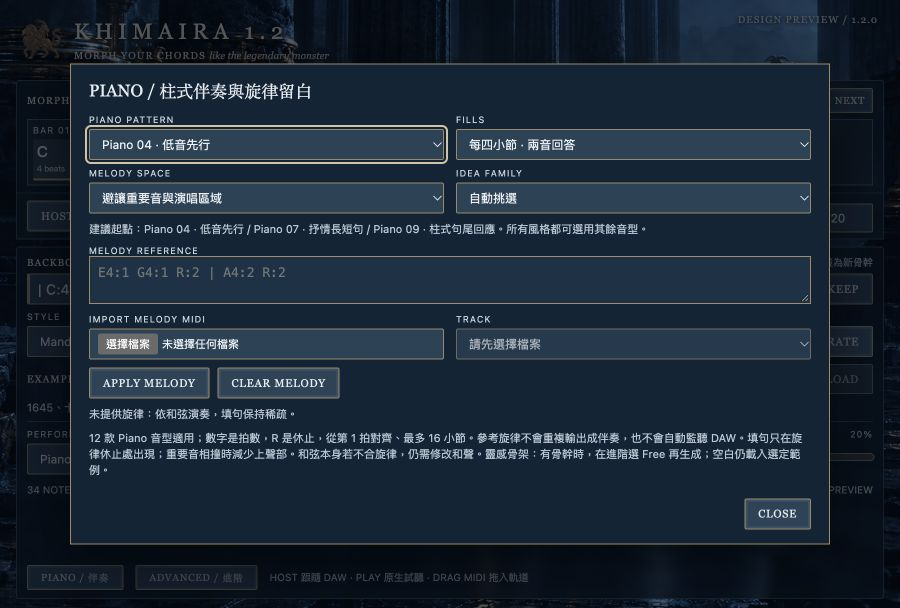
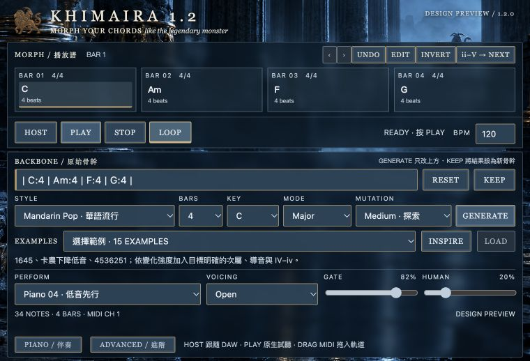
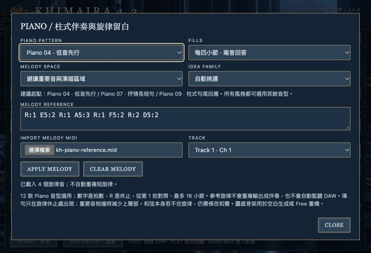
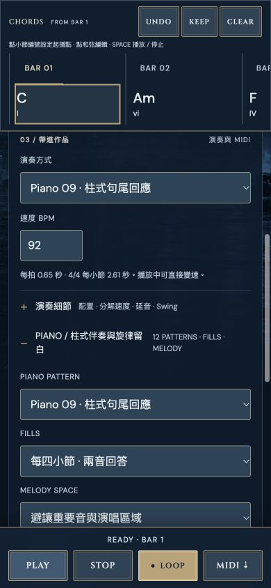

# 鋼琴伴奏與和聲學習整合 · 2026-10-27

已在網站與 1.2 外掛原始碼加入 12 種鋼琴伴奏、保守填句、旋律 MIDI／文字參考，以及從三份 20261027 教材整理出的原創和聲研究。來源、規則、適用風格與限制詳見 [Khimairachord.md](../Khimairachord.md)。

## 使用

網站的演奏區展開 **PIANO / 柱式伴奏與旋律留白**；外掛按 **PIANO / 伴奏**。Piano 01–03 是基本柱式，04–10 是左右手、切分與回答的變化，11／12 分別偏 K-pop 與 J-pop 的鋼琴編曲。五個目標風格有建議起點，所有風格均能選 12 款音型。

預設每四小節兩音填句，可關閉。匯入單音旋律 MIDI、選音軌、按 APPLY MELODY，或輸入 `E5:2 R:2`。參考只調整伴奏留白、密度及上聲部，不輸出旋律、不監聽其他 DAW 軌道、不保證任意和聲都能配任意旋律。

Mandarin Pop 的 Free／空白生成可選 1645、Canon、4536251；中高變化使用次屬、IV–iv 或導音減七的目標解決。外掛仍保留「空白 GENERATE 載入目前範例」：可用 EXAMPLES 的新練習，或輸入骨幹、在 ADVANCED 選 Free 後再生成。原始／保留根音模式不強制重寫骨架。

## 變更範圍

- 新增 `dist/harmony-knowledge.js`、`piano-patterns.js`、`melody-reference.js`、`piano-tools.js`。
- 整合 `style-engine.js`、`performance.js`、`example-pool.js`、`example-titles.js`、`contrast-examples.js`；補齊 Ballad 的四種情緒範例及新增研究的唯一標題。
- 網站 `app.js`、`index.html`、`odyssey.css`：收合面板、設定保存、正確匯出新音型、更新入口資源版本。
- 外掛 `web/index.html`、`plugin.js`、`plugin.css`、`pattern.js`、`session.js`：獨立設定視窗、專案狀態、同一份演奏參數。
- `plugin/scripts/pack.py` 納入共用面板與依賴；`fixtures.mjs` 擴增新音型。
- `tests/learn-piano.test.js` 新增音樂回歸，`tests/plugin-1.2.test.js` 擴增逐音一致檢查。
- 未改 C++ 時鐘／IPC 路徑。共用 music-core 重構是同資料夾另一項工作；保留其檔案，沒有把它當成此次伴奏新增，也沒有修改 Seiren 的策略。

## 驗證結果

| 項目 | 結果 |
| --- | --- |
| `node --test tests/*.test.js` | 119／119 通過，含共用核心相容檢查。 |
| 和聲組合 | 24,192 組：7 風格 × 12 調 × 大小調 × 3 強度 × 4 長度 × 循環／非循環 × 6 seeds；檢查有效和弦、四拍總長、可重現性及非循環主和弦結尾。另有特定下降低音／導音目標斷言。 |
| 12 音型 | 節奏不同、和弦切點、正音長、力度／音域、有界、同音不重疊、可重現；旋律長音禁 fill、密集旋律減音、延後進入的旋律衝突。 |
| 網站與打包引擎 | 20 個引擎依賴逐檔 SHA-256 一致；六款舊音型與十二款新音型在多 seed、voicing、BPM 及旋律設定下逐音一致。 |
| 原生回放 | 72 份八小節資料，含旋律開／關；Instrument 與 MIDI FX 各 432 組，共 864 組通過。三輪循環一致，最大誤差 0.499903 tick @ 480 PPQ。測試使用既有原生測試執行檔，C++ 排程未變。 |
| 原生 PatternPlayer | sample timing、循環、跳轉、BPM、STOP、one-shot、資料驗證與 mailbox 通過。 |
| 外掛操作契約 | session suite 通過；現有 49 風格、411 個範例的 LOAD／INSPIRE／骨幹隔離。原測試成功訊息仍是舊固定數字，實際迴圈逐一遍歷目前清單。 |
| 瀏覽器 | 網站新和聲生成、Piano 09 試聽／停止、MIDI 實際下載；設定重載保存；外掛面板匯入測試 MIDI、保留起始休止、選軌與套用通過，無 console warning/error。 |
| 版面 | 外掛網頁區 900×608／760×518（另保留原生底列 42px）；最小尺寸 body 與 main 的 scroll/client 尺寸相同，主要面板不捲動。鋼琴設定視窗獨立開關。網站 390×844 無水平頁面溢出。 |
| 編譯 | 本機 arm64 AU、VST3、Standalone 成功。編譯器有既有 JUCE ZipFile deprecated warning；非編譯錯誤。 |
| 實際 VST3 載入 | 新 binary 的輸出 bus 測試通過，30 對 MIDI note-on/off、host sync／stop。 |

原生測試輸出的文字仍固定寫「six patterns」；本次輸入檔實際有 72 份、涵蓋 18 種音型，故每個 processor 執行 432 組。這是自動測試宿主，不能冒充 Logic 實錄或 Ableton 驗收。

## 本機交付與未驗收事項

本機測試包：`build-plugin/learn-pop/package/KHIMAIRA-1.2.0-piano-preview-arm64.pkg`。包含 AU MIDI FX、VST3 與 Standalone；保留 1.2.0 身分，安裝會更新同名 1.2 外掛。這是 Apple Silicon 本機測試版，ad-hoc 簽署的 binaries、未簽章公證的 pkg；不是 GitHub 的通用正式版。

本次沒有替使用者安裝、沒有推送 GitHub、沒有重新完成 Logic 實際錄製或 Ableton 驗收；目前安裝與公開版本不因來源修改而自動更新。未驗證 Windows／Intel。伴奏仍為 4/4，沒有新增 CC64 或 DAW 即時旋律輸入。

測試輸出與引擎雜湊：同名資料夾內 `node-tests.txt`、`native-instrument.txt`、`native-midifx.txt`、`session-test.txt`、`engine-manifest.json`。

## 畫面

預設鋼琴面板：

最小外掛主要面板：

最小外掛鋼琴面板與已匯入旋律：

390px 網站：

