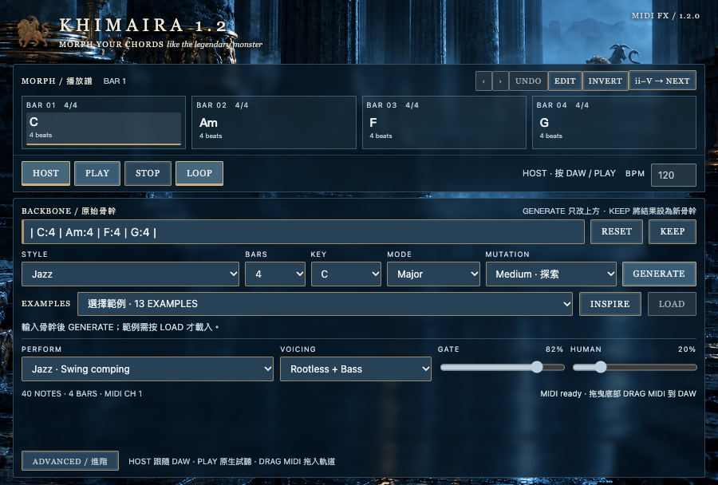
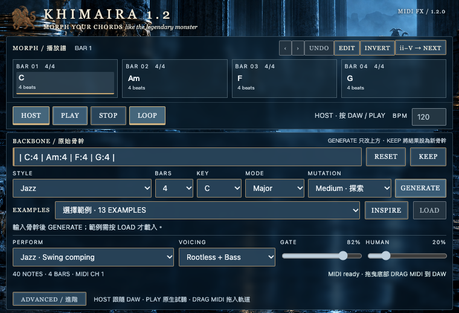
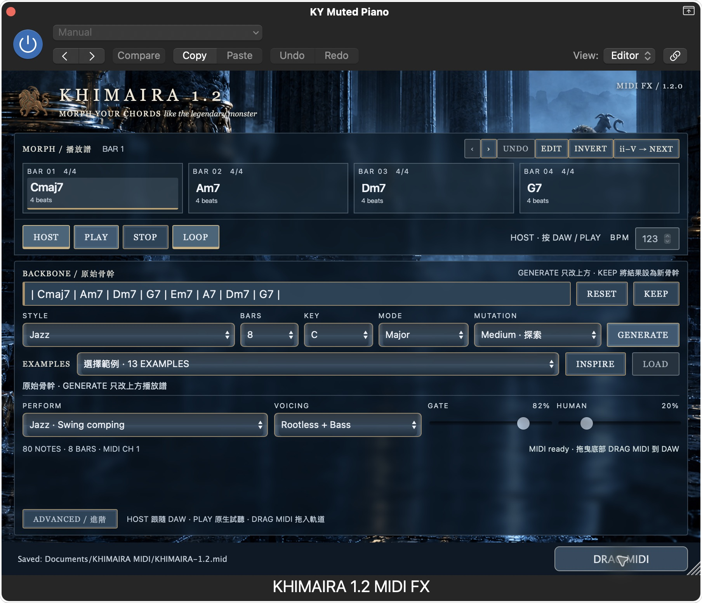

# KHIMAIRA 1.2.0 MIDI FX 重建／驗收報告

2026-10-27。**可安裝測試，尚未達到全部正式驗收條件。** 網頁 `dist/` 與基準 `078fbcd` 完全相同。

## 完成的重建

找到本機 `Khimaira-Plugin` 舊原始碼；它保留 0.3 MIDI FX 的單頁介面與排程，CMake 標示為後續 0.4 installer preview。本次以這個外殼為基礎，沒有再嵌入網站首頁。

| 檔案 | 變更 |
| --- | --- |
| `plugin/CMakeLists.txt` | 1.2.0；獨立 AU MIDI FX 與 VST3 Instrument + MIDI output；新 code/bundle ID |
| `plugin/Source/Sequence.h` | 完整 pattern mailbox、PPQ/sample 排程、停止與跳轉 note-off、區塊交界正確取整 |
| `plugin/Source/PluginProcessor.*` | HOST 對齊專案第 1 小節；PLAY 原生時鐘使用 host BPM；更新在小節邊界切換；保存完整 notes/UI |
| `plugin/Source/PluginEditor.*` | 0.3 固定版面、900×650／最小 760×560、原生 DRAG MIDI；單擊存至 Documents/KHIMAIRA MIDI |
| `plugin/web/{index.html,plugin.css,plugin.js,session.js,pattern.js}` | 舊操作控制接新版引擎；進階對話框、四小節分頁；無網頁播放計時 |
| `plugin/scripts/pack.py` | 只複製 15 個相依引擎模組，SHA256 逐檔驗證與 dist 一致 |
| `plugin/scripts/fixtures.mjs`, `plugin/tests/*`, `tests/plugin-1.2.test.js` | 六種 pattern 的資料／實際 native processor 比對、循環、速度、狀態保存測試 |
| `.github/workflows/plugin.yml`, `plugin/installer/*` | 新 AU 路徑、1.2 識別碼、macOS 12.3+、無內建鋼琴的安裝說明 |

已移除 1.1 的逐音 IPC、PreviewScheduler 路徑、鋼琴取樣播放、網站打包腳本。AU 為 `aumi / Km12 / Khmr`、`music.khimaira.v12.midifx`；VST3 為 `Kh12`、`music.khimaira.v12.instrument`。0.3／1.1 安裝與原專案保留。

## 七項驗收

| # | 結果 | 證據與限制 |
| --- | --- | --- |
| 1 Logic MIDI FX → 音源 | 通過功能驗證 | Logic Pro 11.2.2 的 MIDI FX 選單出現 KHIMAIRA 1.2 MIDI FX，實際插在 Serum 前；PLAY/HOST 產生正常輸出音量訊號，並錄成 MIDI region。AU strict 驗證成功。 |
| 2 8 小節、120 BPM、三輪、≤1 tick | **嚴格標準尚未通過** | 80 notes／輪。Logic 匯出 480 PPQ 後，對原始浮點 beat 最大差 1.01830794 tick；預備拍後第一輪有兩個起點比後續輪早 1 tick。第 2–4 輪位置完全相同。保留原始 MIDI 與失敗輸出，未放寬門檻。 |
| 3 原生 PLAY／host BPM／背景操作 | 功能通過；壓力觀察有範圍限制 | Logic 停止時 PLAY 持續，關閉介面後仍播放；在 Tempo 列表把真正的速度事件從 122 改到 123，外掛立即顯示 123 並繼續。開啟 Activity Monitor 後仍持續。原生測試另驗證 120→180 與 UI 不推進音訊時鐘；未用音訊量測儀量化整台系統負載。 |
| 4 六種 pattern 逐音一致 | 通過 | jazz/pop/rock/ballad/house/arp，24 份 8 小節 fixture；native 保留 beat/duration/note/velocity 原值。每種跑 64/257/1024 samples，AU 和 Instrument 各 72 案例，共 144。 |
| 5 預設／最小介面 | 版面測試通過 | 同一份打包介面在 900×608／760×518（扣除 42px 原生 footer）無捲動、無重疊；進階區也通過。附兩尺寸瀏覽器截圖及 Logic 預設尺寸實機圖。未把未成功的原生視窗拖曳操作當作最小尺寸實機證據。 |
| 6 Ableton VST3 路由 | **待實機驗證** | 本機未找到 Live，已詢問安裝位置。實際 VST3 binary 在 JUCE host harness 載入，MIDI event output bus、30 組 note-on/off、HOST/STOP 均通過；這不等於 Live 實測。 |
| 7 Node／native tests | 通過本機 | Node 98 項；原生 CTest 3/3。純 scheduler 與完整 processor 測試通過；原生最大誤差 0.00999614 tick／480 PPQ，三輪 sample 位置相同。Windows CI 2/2、Mac CI 3/3 也通過。 |

### Logic 錄製方法與嚴格重測

使用獨立測試副本，不改原使用者專案。依 [Apple 的 Record MIDI to Track Here 方法](https://support.apple.com/guide/logicpro/record-midi-to-track-lgcp423beea5/mac)，在 KHIMAIRA 下方設錄製點；120 BPM、Quantize Off、1 小節預備拍，錄製超過 32 小節並匯出 Selection as MIDI File。

進行：`Cmaj7 | Am7 | Dm7 | G7 | Em7 | A7 | Dm7 | G7`。Jazz、Rootless + Bass、Gate 82、Human 20、Swing 16、seed 42。

```sh
node plugin/scripts/verify-logic.mjs docs/plugin-1.2/logic-host-120.mid
```

這個命令目前故意保留嚴格失敗，不能用 native unit tests 取代 Logic 驗收。差異可能包含 Logic 錄製／MIDI 匯出取整，但尚未證明根因，不能宣稱只是匯出問題。無預備拍的首次錄製另缺第一組起音，因此本報告採用有預備拍的檔案。

最初的 BPM 操作曾只改到 Logic 顯示欄，實際 Tempo 事件仍為 120；後來直接從 Tempo 列表確認與修改，排除這次測試操作造成的誤判。不是已確認的外掛 BPM 故障。

## 證據

- [Node 98 tests](node-tests.txt)、[native tests](native-tests.txt)、[AU validation](auval-arm64.txt)、[actual VST3 binary test](vst3-binary-test.txt)
- [版面測試](browser-tests.txt)、[Logic 原始錄製 MIDI](logic-host-120.mid)、[嚴格錄製比對結果](logic-recording-strict.txt)
- [Logic 實錄畫面](logic-recorded.png)、[單擊匯出驗證：80 組音符／note-off、32 beats](midi-save-test.json)、[安裝包內容及 SHA256](package-validation.json)

預設打包介面：



最小打包介面：



Logic 實機預設視窗與匯出結果：



## 安裝與使用

Mac Universal（arm64 + x86_64）AU/VST3/App 已編譯並完成 ad-hoc 簽章驗證。此 Mac 已安裝到使用者 Library／Applications；安裝包為 `KHIMAIRA-1.2.0-mac.pkg`。arm64 AU 嚴格驗證通過；Intel 架構存在，但本機 Rosetta auval 未找到 component，不能算 Intel DAW 驗收。未做 Apple Developer 公證。

Logic：MIDI FX → Audio Units → KHIMAIRA → **KHIMAIRA 1.2 MIDI FX**；下方 Instrument 放 Serum／Logic 音源。VST3 以樂器載入，再把 MIDI 輸出接另一條樂器軌。沒有內建音色。單擊 DRAG MIDI 存到「文件／KHIMAIRA MIDI」，真正的跨視窗拖放仍待使用者 DAW 操作補測。

[GitHub Actions #5](https://github.com/BBCODE1111/Khimaira/actions/runs/40379697800) 的 verify-web、Mac、Windows、package 四個工作全部成功（commit `a5ca8ad`）。Windows 原生測試 2/2 通過，安裝程式與 VST3 ZIP 已產生；[測試摘錄](windows-ci.txt)。第一輪測試程式曾因大型 processor 配置在 stack 崩潰，已改為 heap 後重跑通過。

正式版前仍需完成第 2、6 項，及 Windows／Intel 的實際 DAW 覆蓋驗證。本次不建立「全部驗收通過」的正式標籤。
